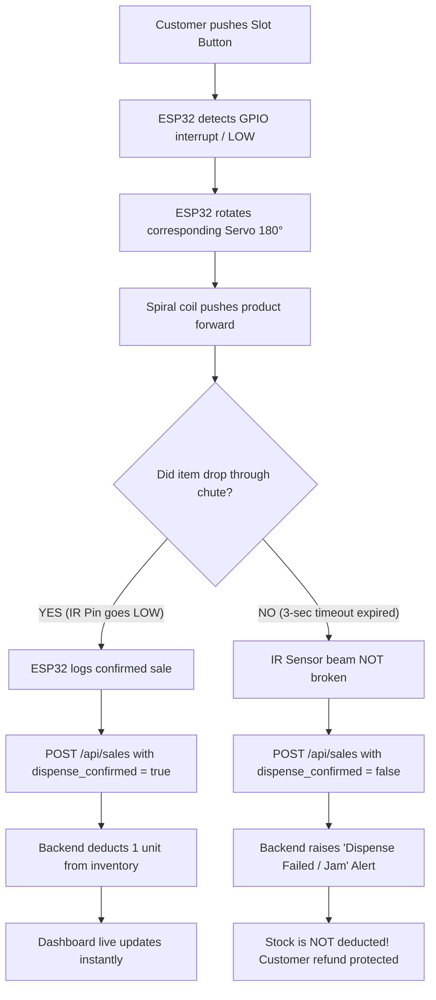

# SmartVend AI – ESP32 Hardware Integration & Wiring Guide

This guide is designed for building the physical 3-slot cardboard smart vending machine using the **ESP32 NodeMCU 30-Pin CP2102** development board.

---

## 1. Bill of Materials (BOM)

| Component | Quantity | Purpose | Operating Voltage |
| :--- | :---: | :--- | :--- |
| **ESP32 NodeMCU 30-Pin** | 1 | Master IoT Controller (Wi-Fi, HTTP client, Logic) | 5V (via micro-USB) / 3.3V logic |
| **Servo Motors (SG90 or MG995)** | 3 | Rotates coil / ejects items from Slots 1, 2, 3 | 4.8V – 6.0V (High current!) |
| **IR Obstacle Avoidance Sensors** | 3 | Detects when product crosses drop chute | 3.3V – 5.0V |
| **Tactile Push Buttons** | 3 | Customer slot selection buttons | 3.3V (Active LOW) |
| **External 5V / 2A Power Supply** | 1 | Dedicated power for servo motors | 5V DC regulated |
| **Breadboard & Jumper Wires** | 1 kit | Connections & common ground bus | N/A |
| **Cardboard Enclosure & Coils**| 1 set | DIY chassis with 3 dispensing spirals | N/A |

---

## 2. Pin Mapping Table

### A. Customer Push Buttons
*Note: Configured with internal `INPUT_PULLUP`. Wire one button leg to the GPIO pin and the other leg to ESP32 **GND**.*

| Button | Slot Assignment | ESP32 GPIO Pin | Normal State | Pressed State |
| :--- | :--- | :--- | :--- | :--- |
| **Button 1** | Slot 1 (Chocolate) | **GPIO 13** | HIGH (3.3V) | LOW (0V / GND) |
| **Button 2** | Slot 2 (Biscuits) | **GPIO 14** | HIGH (3.3V) | LOW (0V / GND) |
| **Button 3** | Slot 3 (Chips) | **GPIO 27** | HIGH (3.3V) | LOW (0V / GND) |

---

### B. IR Obstacle Sensors (Drop Chute Verification)
*Ensure IR sensor modules are powered by **3.3V** from ESP32, or use a 2-resistor voltage divider (1kΩ / 2kΩ) if powered from 5V so signal output stays under 3.3V.*

| Sensor | Monitored Slot | ESP32 GPIO Pin | No Item Detected | Item Falling (Beam Broken) |
| :--- | :--- | :--- | :--- | :--- |
| **IR Sensor 1** | Slot 1 Chute | **GPIO 25** | HIGH (3.3V) | LOW (Active detection) |
| **IR Sensor 2** | Slot 2 Chute | **GPIO 26** | HIGH (3.3V) | LOW (Active detection) |
| **IR Sensor 3** | Slot 3 Chute | **GPIO 33** | HIGH (3.3V) | LOW (Active detection) |

---

### C. Servo Motors (Dispenser Actuators)
*Connect Servo PWM signal wires to the respective GPIO pins.*

| Servo | Dispenser Slot | ESP32 PWM Pin | Power Source (VCC) | Ground |
| :--- | :--- | :--- | :--- | :--- |
| **Servo 1** | Slot 1 (Chocolate Coil) | **GPIO 18** | External 5V Power Supply (+) | **COMMON GND** |
| **Servo 2** | Slot 2 (Biscuits Coil) | **GPIO 19** | External 5V Power Supply (+) | **COMMON GND** |
| **Servo 3** | Slot 3 (Chips Coil) | **GPIO 21** | External 5V Power Supply (+) | **COMMON GND** |

---

## 3. Critical Electrical Engineering Rules

> [!WARNING]
> **DO NOT POWER SERVOS FROM ESP32 3.3V OR VIN PINS!**
> When all three servos start moving, they draw peak surge currents of 1.5A to 2.5A. Powering them directly from the ESP32 will cause brownout crashes, continuous reboot loops, or burn the ESP32 voltage regulator.
>
> 1. Use a separate **5V DC (2A or 3A) regulated power adapter** for the servo VCC (red wires).
> 2. **COMMON GROUND REQUIREMENT**: Connect the Negative (-) terminal of the 5V external power supply directly to the ESP32 **GND** pin. Without common ground, PWM signal reference fails and servos will jitter uncontrollably.
> 3. Verify IR sensor VCC: Most LM393 IR modules work stably on 3.3V. Powering them with 3.3V ensures the OUT pin is safe for ESP32 GPIO inputs.

---

## 4. Software Verification Flow

---

## 5. Arduino IDE Flashing Instructions

1. Install **ESP32 Board Package** in Arduino IDE (`File > Preferences > Additional Board Manager URLs`: `https://raw.githubusercontent.com/espressif/arduino-esp32/gh-pages/package_esp32_index.json`).
2. Install required libraries from Library Manager:
   - `ESP32Servo` by Kevin Harrington
   - `ArduinoJson` by Benoit Blanchon (v6 or v7)
3. Open `esp32/smartvend_esp32.ino`.
4. Update `WIFI_SSID`, `WIFI_PASSWORD`, and `SERVER_BASE_URL` (use your laptop's local IP, e.g. `http://192.168.1.100:8000`).
5. Select Board: **ESP32 Dev Module** or **NodeMCU-32S**.
6. Set Upload Speed: **115200** or **921600**.
7. Connect USB cable, select the CP2102 COM/Serial port, and click **Upload**.
8. Open Serial Monitor at **115200 baud** to view real-time Wi-Fi handshake, button triggers, and HTTP POST responses!
